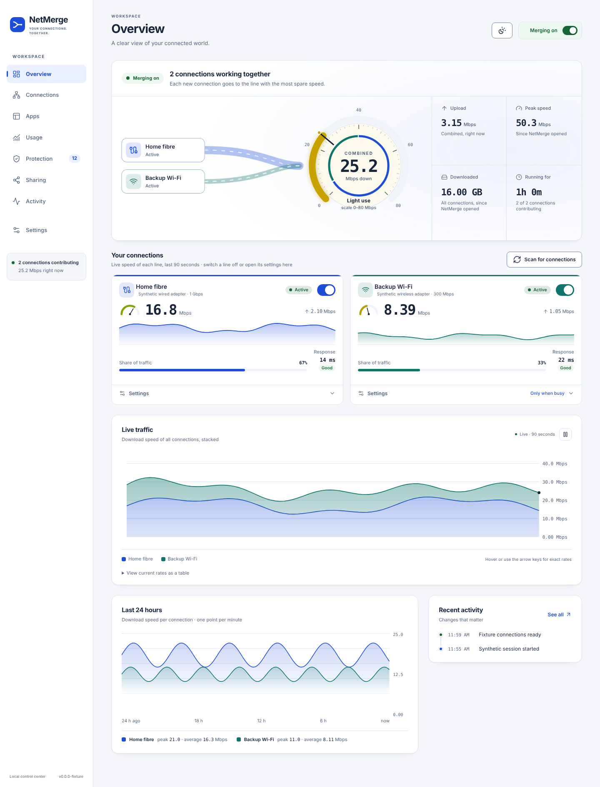
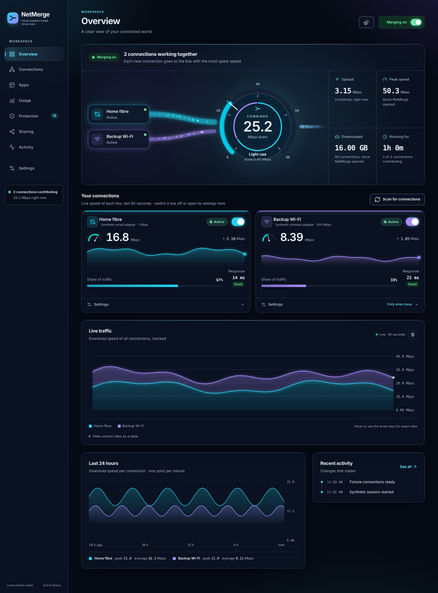
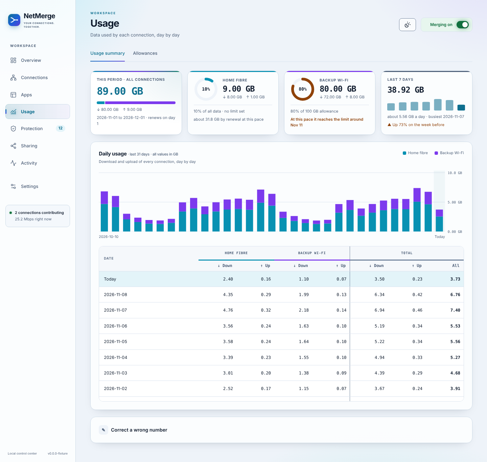
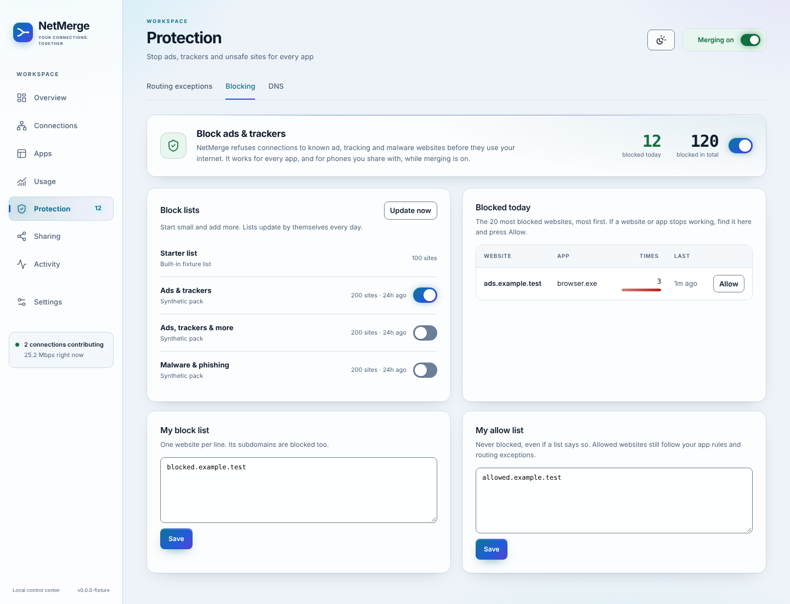

# NetMerge

Combine two or three internet connections (for example a LAN cable and Wi-Fi from two different providers) into one faster connection on **Windows 11**, with no extra hardware, no paid service and no relay server.

NetMerge is one small program: a friendly window, and its own network engine built in (see `engine/`), written for NetMerge only and nothing else to download. A benchmark measures the engine on every change (start time, new connections, downloads, block accuracy, memory and CPU).

## Screenshots

| Overview | Overview (dark) |
|---|---|
|  |  |
| **Usage** | **Ad and tracker blocking** |
|  |  |

More pages (connections, speed test, apps, sharing, settings, narrow window) are in [docs/screenshots](docs/screenshots). They show made-up test data, not a real PC.

## What it does

- **Merges your connections.** In the default mode every new connection a program opens is handed to the line with the most spare speed right now (or, if you prefer, each website stays on one line, or everything uses one line with the others as backup), so downloads, uploads and many-connection programs (browsers, torrent clients, game launchers) use all lines at once.
- **Per-app control.** Send a program to one line only, or keep it off the merge.
- **Usage tab.** Download and upload per connection per day, monthly allowance, warnings and a forecast.
- **Share with your phone.** Scan a QR code with a free app (Hiddify, v2rayNG, Streisand, Shadowrocket) and the phone uses the merged connection too. Connected devices are listed and can be named.
- **Ad and tracker blocking** with downloadable filter lists.
- **Link roles.** Use a line always, only when the others are busy, or only as a backup (for example a phone hotspot with limited data).
- **Same-provider warning.** If two lines leave through the same public address, NetMerge tells you merging cannot add speed.
- **Diagnostics export.** One click saves the logs, settings (without passwords) and a summary.
- **Quality score, activity log and 24-hour graph.** See how steady each line is and what NetMerge changed.
- **Calls protection.** Meeting apps use one steady line; with Smart balancing, new downloads go mostly to the other lines during a call.
- **Presets and schedule.** Gaming, work, travel and more in one click, with your own presets and a time schedule.
- **Backup and restore** of settings, plus a first-run guide.
- **Health checks.** A line without internet is left out until it works again.
- **A speed test made for merged lines** (see [Measuring the merged speed](#measuring-the-merged-speed)).
- **Tray icon, start with Windows, update notifications.**

### An honest limit

One single connection (one download stream) can only use one line. A download manager that fetches a file in pieces over several connections gets around this. The gain comes from many connections at once, which is what browsers, download managers and most apps do. A single-stream speed test will show one line's speed (see the next section).

### Measuring the merged speed

To see what merging really gives you, use the speed test built into NetMerge: **Connections → Speed test**. Website and app speed tests are not a reliable way to measure merged lines:

- Many of them download over one connection, or only a few, from one server. One connection can only use one line, so the result often shows a single line's speed, not the merged speed.
- They are made to measure one internet line, so they cannot tell you what each of your lines gives or how much merging adds.

NetMerge's speed test is made for merged lines. It measures:

1. **Each line on its own**, with one download stream and with eight, so you know what each line can do.
2. **All lines together**, downloading from each line directly at the same time. This is the most the lines can give at this moment.
3. **Through NetMerge**, with 1, 2, 4, 8, 16 and 32 parallel downloads, which is how real apps use the network. This is the speed merging gives you.

The test downloads from several well-known servers (Google, Cloudflare and others) and spreads the load between them, so one slow or busy server does not lower the result.

For a fair result, close other downloads and streaming while the test runs, and run it more than once: mobile data and Wi-Fi change from minute to minute.

## Install

1. Download `NetMerge.exe` from the [latest release](../../releases/latest).
2. Put it in its own folder (for example `C:\NetMerge`) and run it. Click **Yes** on the administrator prompt (needed to merge connections).
3. Turn on **Merging**. Everything NetMerge needs is inside `NetMerge.exe`; nothing else is downloaded.

Windows SmartScreen may warn about an unknown publisher the first time, because the file is not code-signed. Choose *More info → Run anyway*, or build it yourself (below).

### Requirements

- Windows 11 (64-bit), administrator rights
- Two or more active connections with a default gateway
- Other firewall or VPN drivers can conflict with the virtual adapter. NetMerge tells you if it finds one (for example AdGuard's network driver).

## Downloads

The download manager that used to be part of NetMerge is now a program of its own, **Pullwell**
(https://github.com/nisar87/pullwell). Like any download manager it opens many connections, and while NetMerge is on
those connections are spread over all your lines. If you used the old download manager, open **Settings** in
NetMerge and choose **Save old list**, then import that file in Pullwell. Files you already downloaded and the old
list stay where they are.

## Updates

NetMerge looks for a new release on GitHub a few times a day. When there is one, a banner appears with **Update now**. It downloads `NetMerge.exe`, checks it against the SHA-256 published with the release, swaps it in, keeps the old one as `NetMerge-previous.exe` and restarts. **Settings** has a switch to turn automatic checks off.

## Build from source

```
go vet ./... && go test ./...
GOOS=windows GOARCH=amd64 CGO_ENABLED=0 go build -ldflags "-s -w -H=windowsgui" -o NetMerge.exe .
python3 scripts/check-windows-icon.py NetMerge.exe
```

The window (HTML, CSS, JavaScript) is embedded from `ui/`. You can run the app on Linux or macOS for interface work; it then uses fake data.

Every Windows build automatically embeds the NetMerge icon from the committed architecture-specific `.syso` resource. CI and releases verify the embedded icon; see [Windows icon maintenance](assets/windows/README.md) to regenerate it after changing the logo. Before testing a different EXE, choose **Quit NetMerge** from the existing tray icon: closing its window leaves the old instance running, and launching a second EXE opens that existing instance.

### Publish a release

1. Change the number in `VERSION` (and `appVersion` in `update.go`, which CI checks matches).
2. Add a `## x.y.z` section to `CHANGELOG.md` (it becomes the release notes and the "What's new" in the app).
3. Push to `main`. The *Release* workflow builds `NetMerge.exe` and `NetMerge.exe.sha256` and publishes release `vx.y.z`. Everyone's app finds it within hours (or at once with *Settings → Check for updates*).

## Safety notes

- The proxy-sharing port is opened to the local network only, needs a password, and refuses addresses outside private ranges.
- Updates are verified by SHA-256 published in the same release, over HTTPS from github.com only. This protects against corrupted downloads. Protect your GitHub account with two-factor authentication, because whoever can publish a release can publish an update.

## Code signing policy

NetMerge.exe is currently **not signed**, so Windows and browsers may warn that it is not commonly downloaded.
The project has applied to the [SignPath Foundation](https://signpath.org/) for free code signing for open source projects;
the application is pending and **no release is signed yet**. If it is accepted, this section will say so and name the
signing team. Read the draft policy (roles, privacy, system changes) in
[docs/CODE_SIGNING_POLICY.md](docs/CODE_SIGNING_POLICY.md).

Until releases are signed, check the SHA-256 published next to each download (`NetMerge.exe.sha256`) against the file you got.

## Files

| Path | Purpose |
| --- | --- |
| `*.go` | The app (engine control, dispatcher, usage, sharing, updates, tray) |
| `engine/` | The network engine, built into `NetMerge.exe` (its own Go module; see `engine/README.md`) |
| `ui/` | The window |
| `scripts/` | `STOP.bat`, `ROLLBACK.bat` (restore the previous version) |
| `data/` | Created at runtime: settings, usage, logs (not in git) |

## License

MIT. `NetMerge.exe` carries Wintun (wintun.net), the virtual network adapter driver of the WireGuard project, which may be redistributed with software that uses it.
